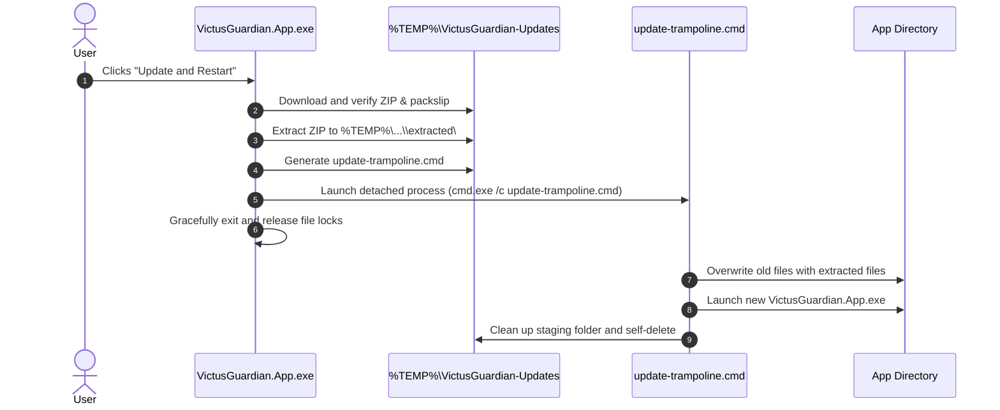

# Lightweight In-App Update Mechanism Specification

**Target:** Windows 11 x64 Portable Distribution  
**Product:** Victus Battery Guardian  
**Status:** Design / Specification Phase (Milestone 5.1 Architecture)  
**Implementation Target:** Milestone 5.2  

---

## 1. Executive Summary & Design Constraints

Victus Battery Guardian is designed as an ultra-low-overhead, portable utility that spends most of its lifecycle minimized in the system tray. The in-app update mechanism must adhere to strict principles:

1. **Zero Persistent Background Services:** No separate updater service, Windows Service, or scheduled tasks running in the background.
2. **Client-Initiated & On-Demand:** Update checks run purely through standard HTTPS requests from within the running Avalonia process (e.g. at startup or when manually triggered by the user via Settings).
3. **No External Server Infrastructure:** All releases, metadata, and assets are hosted directly on GitHub Releases (`https://github.com/daoistmadness/victus-battery-guardian`).
4. **Non-Destructive Data Preservation:** User configuration (`settings.json`) and historical telemetry (`battery_history.db`) are stored in `%LOCALAPPDATA%\VictusBatteryGuardian\`, completely separated from the application binary directory.
5. **Fail-Closed Security:** Unverified or corrupted binaries are never executed.

---

## 2. Update Discovery & Channel Filtering

### 2.1 GitHub Releases REST API
The application queries GitHub's public API:
```http
GET https://api.github.com/repos/daoistmadness/victus-battery-guardian/releases
Accept: application/vnd.github+json
User-Agent: VictusBatteryGuardian/<currentVersion>
If-None-Match: "<lastEtag>"
```
- **Rate-Limiting Protection:** Uses HTTP `ETag` / `304 Not Modified` caching to avoid consuming GitHub API limits.
- **Failover:** If rate-limited or offline, the update check quietly aborts without interrupting the user.

### 2.2 Channel Selection
Users configure their desired release channel in the Settings UI:
- **Stable Channel (Default):**
  - Filters releases where `draft == false` AND `prerelease == false`.
  - Enforces mandatory cryptographic signature verification.
- **Preview Channel (Opt-In):**
  - Filters releases where `draft == false` AND `prerelease == true` (e.g., `v0.2.0-preview.*`).
  - Clearly alerts user to unsigned preview status while verifying SHA-256 integrity and CI provenance against the Packslip manifest.

### 2.3 Semantic Version Comparison
Versions are evaluated using standard SemVer 2.0:
- Strips leading `v` prefixes (e.g. `v0.2.0` -> `0.2.0`).
- Splits major, minor, patch, and prerelease identifiers.
- A release is offered only if `TargetVersion > CurrentVersion`.

---

## 3. Download & Staging Architecture

When the user accepts an update:
1. **Isolated Staging Directory:**
   ```
   %TEMP%\VictusGuardian-Updates\<targetVersion>\
   ```
2. **Target Assets Downloaded:**
   - User Application Archive: `VictusGuardian-v<targetVersion>-win-x64.zip`
   - SHA-256 Hash File: `VictusGuardian-v<targetVersion>-win-x64.zip.sha256`
   - Release Packslip Manifest: `VictusGuardian-v<targetVersion>-packslip.json`
3. **Cancellation & Progress:**
   - Implemented via `HttpClient.GetStreamAsync` with `IProgress<double>` reporting to the UI.
   - Accepts standard `CancellationToken` allowing the user to cancel at any moment without leaving corrupted state.

---

## 4. Verification Gate (Integrity & Cryptographic Security)

Before any archive is unpacked:
1. **SHA-256 Digest Verification:**
   - Computes the SHA-256 hash of the downloaded `.zip`.
   - Validates that the hash matches the entry in `VictusGuardian-v<targetVersion>-packslip.json` and the `.sha256` checksum file.
2. **Channel-Specific Security Checks:**
   - **Stable Channel:** Verifies that the manifest contains genuine cryptographic signing (e.g. Sigstore cosign bundle or Authenticode digital signature on `VictusGuardian.App.exe`). If unsigned, the update is rejected.
   - **Preview Channel:** Validates Packslip manifest provenance and displays an explicit "Unsigned Preview" confirmation prompt.
3. **Fail-Closed Reaction:** If any check fails, the staged directory is purged immediately and the update is aborted with a clear diagnostic error.

---

## 5. Safe Windows Binary Replacement Pattern (Trampoline Update)

On Windows, an actively executing `.exe` is locked with `ERROR_SHARING_VIOLATION` (`0x20`) and cannot be overwritten in place.

### The Lightweight Trampoline Script
The updater resolves this using a transient command script without external helper binaries:



### Trampoline Script Implementation (`update-trampoline.cmd`):
```cmd
@echo off
setlocal
set "STAGING=%~1"
set "TARGET=%~2"
set "PID=%~3"

:: Wait up to 5 seconds for the parent process to release file locks
:WAIT_LOOP
tasklist /fi "PID eq %PID%" 2>nul | findstr /i "%PID%" >nul
if not errorlevel 1 (
    timeout /t 1 /nobreak >nul
    goto WAIT_LOOP
)

:: Copy updated binaries over the existing application directory
copy /y "%STAGING%\*" "%TARGET%" >nul
if errorlevel 1 (
    echo Update failed to overwrite binaries.
    exit /b 1
)

:: Launch the updated application
start "" "%TARGET%\VictusGuardian.App.exe"

:: Cleanup staging files and delete this trampoline script
rd /s /q "%STAGING%" >nul 2>&1
(goto) 2>nul & del "%~f0"
```

---

## 6. Preservation of User State & Data Isolation

The update process only touches files inside the application install/extraction directory:
- `VictusGuardian.App.exe`
- `README.md`
- `LICENSE`
- `VERSION.txt`

The user's persistent state is completely preserved:
- `%LOCALAPPDATA%\VictusBatteryGuardian\settings.json` (Charge thresholds, poll intervals, notifications)
- `%LOCALAPPDATA%\VictusBatteryGuardian\battery_history.db` (Historical telemetry and SQLite WAL files)

Neither the trampoline script nor the extraction process accesses `%LOCALAPPDATA%`, preventing accidental history resets.

---

## 7. Fault Recovery & Rollback

1. **Interrupted Download:** The partial download in `%TEMP%` is discarded.
2. **Hash Mismatch:** Binaries are deleted; no replacement is attempted.
3. **Lock Timeout:** If the application takes longer than 5 seconds to terminate, the trampoline exits without modifying files, leaving the previous version intact.
4. **Crash on Launch:** The previous extraction directory can retain a `.bak` backup of the old `.exe` for one-click rollback if required.
